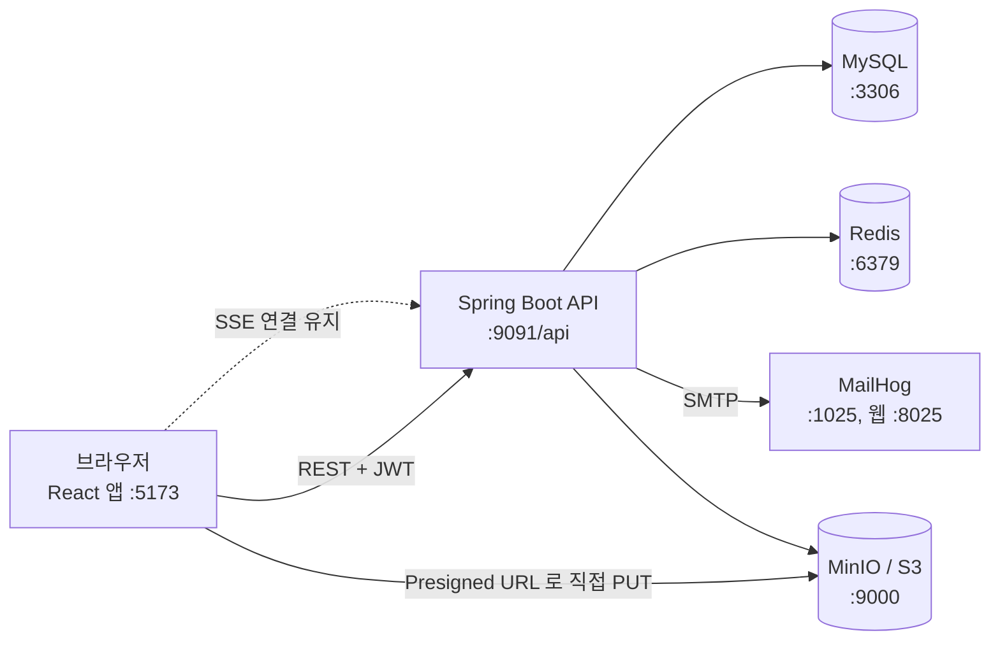
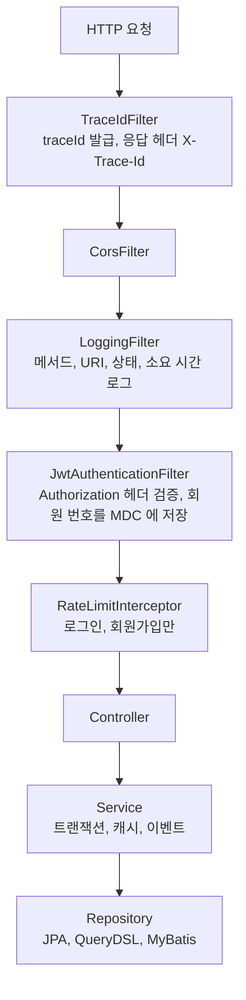
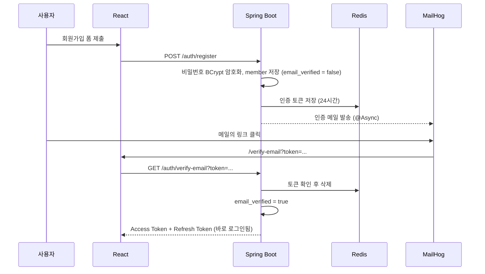
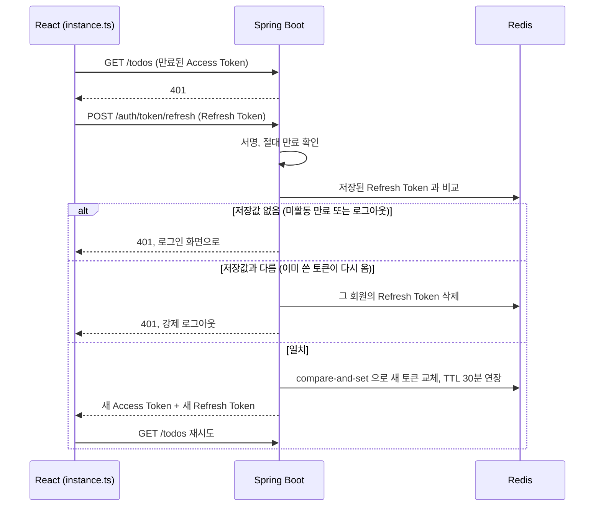
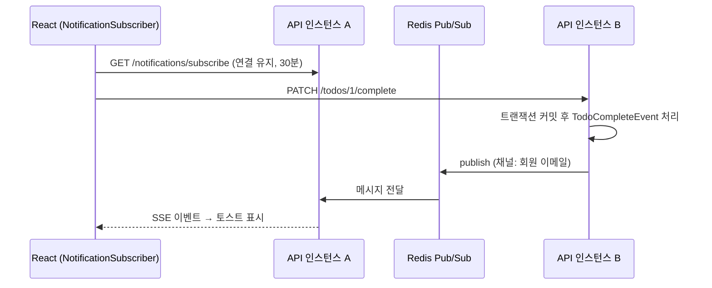
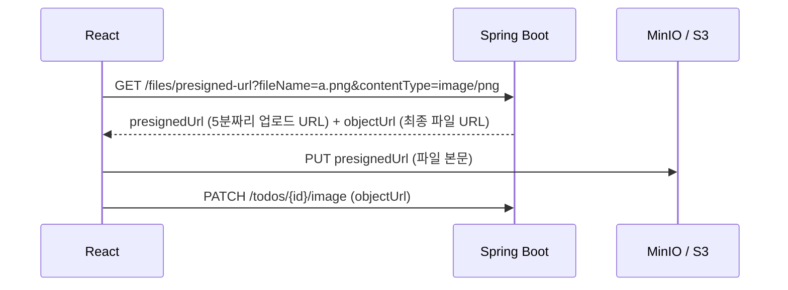

# 전체 동작 설명

이 문서는 보일러플레이트가 "어떻게 돌아가는지"를 한곳에서 설명한다.
실행 방법은 루트 README 와 각 프로젝트 README 를, 코딩 규칙은 각 프로젝트의 CLAUDE.md 와 `.claude/rules/` 를 본다.
FE 코드를 Spring 개념에 대응해 읽는 방법은 [FRONTEND_FOR_BACKEND_DEVS.md](FRONTEND_FOR_BACKEND_DEVS.md) 에 있다.

## 1. 이 보일러플레이트의 성격

- 실제 서비스가 아니라 **새 프로젝트의 출발점**이다. 화면과 기능은 업무 기획이 아니라 기술 패턴을 보여 주기 위한 예제다.
- 예제 도메인은 회원(member)과 할 일(todo) 두 개뿐이다. 새 서비스를 만들 때는 todo 를 지우고 같은 패턴으로 자기 도메인을 추가한다.
- 예제를 지우는 방법은 [react-boilerplate/README.md](../react-boilerplate/README.md) 의 "예제 기능 제거 방법"을 본다.

## 2. 구성 요소



| 구성 요소 | 하는 일 | 로컬에서 확인하는 곳 |
|-----------|---------|----------------------|
| React 앱 | 화면, API 호출, 토큰 보관 | http://localhost:5173 |
| Spring Boot API | 인증, 업무 로직, DB 접근 | http://localhost:9091/api/swagger-ui.html |
| MySQL | 회원, 할 일 저장 | DB 클라이언트로 3306 접속 |
| Redis | Refresh Token, 인증 메일 토큰, 목록 캐시, 요청 횟수 제한, 알림 전달 | `redis-cli` |
| MinIO | 첨부 이미지 저장 (운영에서는 AWS S3) | http://localhost:9001 (minioadmin / minioadmin) |
| MailHog | 발송 메일을 가로채서 보여 주는 로컬 메일 서버 | http://localhost:8025 |

Redis 키는 `APP:{도메인}:{용도}:{식별자}` 형식이다 (예: `APP:AUTH:REFRESH_TOKEN:3`, `APP:CACHE:todo:list:...`). 규칙은 `springboot-boilerplate/.claude/rules/configuration.md` 의 "Redis 키 규칙"을 본다.

로컬 인프라는 `springboot-boilerplate/docker-compose.yml` 로 띄운다. 처음 실행할 때 `docker/init.sql` 이 테이블과 샘플 데이터를 만든다.
샘플 계정은 `user1@example.com`, `user2@example.com`, `admin@example.com` 이고 비밀번호는 init.sql 주석에 있다.

## 3. 요청 하나가 처리되는 순서

### 3-1. 백엔드 필터와 계층



- **traceId:** 요청마다 16자리 ID 를 만들어 모든 로그 줄에 찍는다. 응답 헤더 `X-Trace-Id` 로도 돌려준다. 사용자가 오류를 신고할 때 이 값을 받으면 서버 로그에서 그 요청만 골라 볼 수 있다.
- **회원 번호:** 로그인한 요청이면 JWT 의 `mid` claim 에서 회원 번호를 꺼내 함께 찍는다. 이메일은 개인정보라 로그에 남기지 않는다. 특정 회원의 요청만 보고 싶으면 `m:<회원 번호>` 로 검색한다.
- 두 값 모두 `@Async` 로 실행되는 메일 발송 로그에도 이어진다. 요청이 끝나면 가장 바깥의 TraceIdFilter 가 MDC 를 비운다.

```
[7d6b7e8b935d44b0 m:3] c.e.api.config.security.LoggingFilter : [REQUEST] GET /api/todos → 200 (161ms)
[f924c0d53efa4145]     c.e.api.config.security.LoggingFilter : [REQUEST] GET /api/health → 200 (1ms)
```
- **인증:** 공개 경로(로그인, 회원가입, Swagger 등)는 `SecurityConfig` 의 `PERMIT_ALL_PATTERN_LIST` 에 있다. 나머지는 유효한 Access Token 이 필요하다.
- **권한:** 관리자 API 는 `@PreAuthorize("hasRole('ADMIN')")` 로 막는다.
- **응답 형식:** 성공은 `BaseResponse<T>`, 실패는 `ExceptionAdvice` 가 `ApiStatus` 코드와 메시지로 감싼다. `statusCode` 에는 `OK`, `AUTH_LOGIN_FAILED`, `TODO_NOT_FOUND` 처럼 enum 이름이 들어가고, HTTP 상태도 enum 에 묶여 있다. 규칙은 `springboot-boilerplate/.claude/rules/api-response.md` 를 본다.

### 3-2. DB 읽기와 쓰기 분리

`MainDataSourceConfig` 는 Writer 와 Reader 두 DataSource 를 두고 `@Transactional(readOnly = true)` 이면 Reader 로 보낸다.
로컬에서는 둘 다 같은 MySQL 을 가리키므로 차이가 없다. 운영에서 읽기 복제본을 붙일 때 설정만 바꾸면 된다.

### 3-3. 프론트엔드에서 API 를 부르는 순서

백엔드 개발자 관점으로 대응시키면 다음과 같다.

| FE 요소 | 역할 | BE 로 치면 |
|---------|------|------------|
| `features/*/apis/*.ts` | axios 로 API 를 호출하는 함수 모음 | Feign Client, RestTemplate 래퍼 |
| `features/*/hooks/use*.ts` | TanStack Query 로 호출 결과를 캐시하고 로딩, 오류 상태를 관리 | 캐시가 붙은 Service |
| `shared/apis/queryKeys.ts` | 캐시 키 정의. 변경 후 어떤 목록을 다시 불러올지 정함 | `@Cacheable` 의 key, `@CacheEvict` 대상 |
| `shared/apis/instance.ts` | 모든 요청에 토큰을 붙이고, 401 이면 토큰을 갱신해 재시도. 403, 500 은 화면에 토스트로 알림 | 공통 인터셉터, `@ControllerAdvice` |
| `app/stores/*.ts` (Zustand) | 로그인 사용자, 토스트, 다이얼로그 같은 전역 상태 | 세션 저장소, 싱글턴 빈 |
| `mocks/` (MSW) | 백엔드 없이 개발할 때 API 응답을 가짜로 돌려줌. `VITE_ENABLE_MSW=true` 일 때만 동작 | WireMock |

화면은 `features/<기능>/pages` 에 있고, 여러 화면이 같이 쓰는 부품은 다음 위치에 있다.

| 위치 | 내용 |
|------|------|
| `shared/components/ui/` | Button, Input, FormField(라벨, 오류 문구 묶음), EmptyState, Dialog, Toast, LoadingSpinner |
| `app/layout/Layout.tsx` | 로그인 후 화면의 상단 바 (메뉴, 로그인 이메일, 로그아웃). 관리자 메뉴는 ROLE_ADMIN 에게만 보임 |
| `features/auth/components/AuthCard.tsx` | 로그인, 회원가입 등 인증 화면이 같이 쓰는 가운데 카드 |

입력 폼은 react-hook-form 으로 상태를 관리하고 zod 스키마로 검증한다. BE 의 `@Valid` + DTO 검증 어노테이션과 같은 역할이다.
스키마는 `features/auth/types/authForm.ts`, `features/todo/types/todo.ts` 에 있다.
디자인을 바꿀 때는 `shared/components/ui/` 의 부품만 고치면 전체 화면에 반영된다.

## 4. 인증 흐름

### 4-1. 회원가입과 이메일 인증



- 인증하지 않은 계정으로 로그인하면 403 이 난다. 인증 링크가 만료됐으면 인증 화면의 재발송으로 메일을 다시 받는다 (`POST /auth/resend-verification`).
- 로그인과 회원가입은 IP 와 경로마다 **1분에 10번**까지만 허용한다 (`RateLimitInterceptor`). 넘으면 429 다.

### 4-2. 로그인과 토큰

| 토큰 | 유효 기간 (local) | 보관 위치 | 용도 |
|------|-------------------|-----------|------|
| Access Token | 15분 | 브라우저 localStorage (Zustand persist) | 모든 API 의 `Authorization: Bearer` 헤더 |
| Refresh Token | 아래 세션 정책을 따름 | 브라우저 localStorage, 서버 Redis 에도 회원당 1개 | Access Token 재발급 |

모든 토큰에는 고유 ID(jti)가 들어간다. 같은 순간에 발급해도 토큰이 서로 달라서 재사용 감지와 차단 목록이 정확하게 동작한다.

**세션 만료 정책**

| 정책 | 기본값 | 동작 |
|------|--------|------|
| 미활동 만료 | 30분 | Refresh Token 의 Redis TTL. 토큰을 재발급할 때마다 다시 30분으로 늘어난다. 30분 동안 아무 요청이 없으면 재발급이 실패해 다시 로그인해야 한다 |
| 절대 만료 | 12시간 | 최초 로그인 시각(`authTime`) 기준 상한. Refresh Token 의 만료 시각을 `authTime + 12시간` 으로 잡고 재발급해도 `authTime` 을 이어받는다. 계속 활동해도 12시간이 지나면 다시 로그인해야 한다 |

- 값은 `application.yml` 의 `jwt.session-idle-timeout-ms`, `jwt.session-absolute-timeout-ms` 이고 환경변수 `JWT_SESSION_IDLE_TIMEOUT_MS`, `JWT_SESSION_ABSOLUTE_TIMEOUT_MS` 로 바꾼다.
- Access Token 유효 기간은 미활동 만료보다 짧아야 한다. 길면 Access Token 만으로 계속 요청할 수 있어 미활동 만료가 의미 없어진다. 앱이 시작할 때 이 조건이 깨져 있으면 WARN 로그를 남긴다.

### 4-3. 토큰 갱신 (Refresh Token Rotation)



- 갱신할 때마다 Refresh Token 도 새로 바뀐다. 예전 토큰이 다시 들어오면 탈취로 보고 그 회원의 세션을 모두 끊는다.
- 교체는 Redis Lua 스크립트로 "저장값이 같을 때만 바꾸기"를 한 번에 실행한다. 같은 토큰으로 두 요청이 동시에 와도 하나만 성공한다.
- FE 는 동시에 여러 요청이 401 을 받아도 **갱신 요청을 한 번만** 보내고 나머지는 그 결과를 기다린다.
- 로그아웃은 Redis 의 Refresh Token 을 지우고, 현재 Access Token 을 남은 유효 시간 동안 차단 목록(`APP:AUTH:ACCESS_TOKEN_DENY:<jti>`)에 올린다. 인증 필터가 매 요청 이 목록을 확인하므로 로그아웃한 Access Token 은 바로 401 이 된다. 토큰이 이미 만료됐어도 로그아웃은 항상 성공으로 응답한다.
- 차단 목록 조회 중 Redis 에 장애가 나면 차단하지 않고 통과시킨다. 서비스 전체가 멈추는 것보다, Access Token 유효 기간 15분 동안의 위험을 감수하는 편이 낫다고 본 선택이다.

### 4-4. 비밀번호 재설정

1. 로그인 화면의 "비밀번호를 잊으셨나요?"에서 이메일을 보낸다 (`POST /auth/password/reset-request`).
2. 가입된 이메일이면 재설정 토큰을 Redis 에 30분 동안 저장하고 메일을 보낸다. 가입되지 않은 이메일이어도 응답은 같다 (계정 존재 여부를 숨김).
3. 메일의 링크에서 새 비밀번호를 입력하면 토큰을 확인하고 비밀번호를 바꾼다 (`POST /auth/password/reset`).

### 4-5. 개발용 임시 토큰

`POST /auth/token/temp` 는 비밀번호 없이 이메일만으로 토큰을 발급한다. Swagger 로 API 를 빨리 시험할 때 쓴다.
이메일만 알면 관리자 토큰도 받을 수 있으므로 **local 프로파일에서만** 켜진다.

## 5. 할 일(todo) 예제가 보여 주는 패턴

| 화면 동작 | API | 보여 주는 패턴 |
|-----------|-----|----------------|
| 목록, 완료/미완료 탭, 페이지 | `GET /todos?page&size&status&sort` | QueryDSL 동적 조건, 페이지 응답 `PageResponse`, Redis 캐시 |
| 추가 | `POST /todos` | 입력 검증 (`@Valid`), 캐시 무효화 |
| 완료 체크 | `PATCH /todos/{id}/complete` | 도메인 이벤트 발행, SSE 알림 |
| 사진 첨부 | `GET /files/presigned-url` 후 `PATCH /todos/{id}/image` | S3 Presigned URL 업로드 |
| 삭제 | `DELETE /todos/{id}` | 논리 삭제 (`deleted_at`), 소유권 검증 |

- **소유권 검증:** 모든 수정, 삭제는 `id` 와 로그인 이메일로 함께 조회한다. 남의 할 일 ID 를 넣으면 404 다.
- **완료는 되돌릴 수 없다.** 사진 첨부와 완료는 서로 관계없다. 예제 단순화를 위한 규칙일 뿐 업무 규칙이 아니다.

### 5-1. 목록 캐시

- `TodoService.getTodoList` 는 `todo:list` 캐시에 30분 동안 저장된다. 키는 이메일, 페이지, 크기, 상태, 정렬을 합친 값이다.
- 추가, 완료, 사진, 삭제는 `todo:list` 캐시 전체를 지운다. 예제를 단순하게 하려는 선택이고, 실제 서비스에서는 회원 단위로 지우는 것이 낫다.
- FE 도 TanStack Query 로 한 번 더 캐시한다. 변경 API 가 성공하면 목록 쿼리 키를 무효화해 다시 불러온다.

### 5-2. 완료 알림 (SSE)



- 서버를 여러 대 띄우면 SSE 연결이 있는 서버와 완료 요청을 받은 서버가 다를 수 있다. 그래서 Redis Pub/Sub 로 모든 서버에 알리고, 연결을 가진 서버가 보낸다.
- 이벤트는 `@TransactionalEventListener(AFTER_COMMIT)` 로 처리하므로 DB 저장이 실패하면 알림도 나가지 않는다.
- 브라우저 기본 `EventSource` 는 Authorization 헤더를 못 붙여서, FE 는 `fetch` 스트림으로 SSE 를 읽는다.
- 개발 모드에서는 React StrictMode 때문에 첫 연결이 바로 취소되고 다시 연결된다. 네트워크 탭의 빨간 subscribe 요청 하나는 정상이다.

### 5-3. 사진 업로드 (Presigned URL)



- 파일이 API 서버를 거치지 않으므로 서버 메모리와 대역폭을 쓰지 않는다.
- 로컬에서는 앱이 시작할 때 `LocalS3Initializer` 가 버킷을 만들고 공개 읽기 정책을 건다. MinIO 는 CORS 를 서버 전역 설정으로 처리한다.

## 6. 관리자 화면

- `admin@example.com` 으로 로그인하면 상단 메뉴에 "관리자"가 보이고 `/admin` 에서 회원 목록을 본다.
- FE 는 라우트 가드로 화면 진입을 막고, BE 는 `hasRole('ADMIN')` 으로 API 를 막는다. **FE 가드는 편의용이고 실제 보안은 BE 가 담당한다.**

## 7. 환경과 설정

| 프로파일 | 쓰는 곳 | 로그 | 특징 |
|----------|---------|------|------|
| local | 개발자 PC | 콘솔 | 단일 Redis, 임시 토큰 API, MinIO 버킷 자동 생성 |
| dev / stg | 개발, 검증 서버 | 파일 (`/var/log/app`) | Redis Cluster. 설정은 `config/*/*-dev.yml`, `*-stg.yml` |
| prd | 운영 | 파일 | Redis Cluster. 개발용 API(임시 토큰, MinIO 초기화) 비활성 |

- 실행 프로파일은 `-Dspring.profiles.active=local` 처럼 지정하고, `application.yml` 의 그룹 설정이 데이터소스, 환경, 로그 설정 파일을 함께 불러온다.
- 비밀값은 Jasypt 로 암호화해 `ENC(...)` 로 적는다. 암호화는 `./gradlew jasyptEncrypt` 태스크로 한다.
- FE 환경값은 `react-boilerplate/env/.env.<mode>` 에 두고, 앱 시작 시 `app/config/env.ts` 가 zod 로 검증한다. 새로 복제했다면 `env/.env.example` 을 복사해 `env/.env.local` 을 만든다.

## 8. 테스트와 CI

| 대상 | 도구 | 명령 |
|------|------|------|
| BE 정적 분석 | Checkstyle, PMD | `./gradlew checkstyleMain pmdMain` |
| BE 테스트, 커버리지 | JUnit 5, JaCoCo | `./gradlew test -Pcoverage` (MySQL, Redis 필요) |
| FE 정적 분석 | ESLint, Prettier, tsc | `npm run lint`, `npm run format:check` |
| FE 단위 테스트 | Vitest, Testing Library, MSW | `npm run test:run` |
| FE E2E | Playwright (MSW 모드) | `npx playwright test` |
| 통합 테스트 | ego lite, 실제 BE 와 인프라 | Claude Code 에서 `/qa-scenario all` (시나리오: `docs/qa/scenarios.md`) |

`.github/workflows/be-ci.yml`, `fe-ci.yml` 이 PR 과 main 푸시 때 위 검사를 실행한다.

## 9. 문제가 생겼을 때

| 증상 | 확인할 것 |
|------|-----------|
| 앱 기동 시 DB 연결 실패 | `docker compose ps` 로 MySQL 상태 확인. 다른 경로의 init.sql 을 마운트한 옛 컨테이너면 `docker compose rm -sf mysql` 후 다시 `up` |
| 한글이 깨져 보임 | init.sql 첫 실행 때 문자셋 문제. 현재 init.sql 은 `SET NAMES utf8mb4` 를 쓰므로 볼륨을 새로 만들면 해결 |
| FE 가 다른 포트를 호출 | `env/.env.local` 의 `VITE_API_BASE_URL` 확인 (`http://localhost:9091/api`) |
| 로그인 401 | 비밀번호 확인. MSW 목업 계정과 DB 샘플 계정의 비밀번호는 다르다 |
| 메일이 안 보임 | 메일은 실제로 나가지 않고 MailHog(http://localhost:8025)에 쌓인다 |
| 특정 요청의 서버 로그 찾기 | 브라우저 응답 헤더 `X-Trace-Id` 값으로 로그 검색. 특정 회원은 `m:<회원 번호>` 로 검색 |
